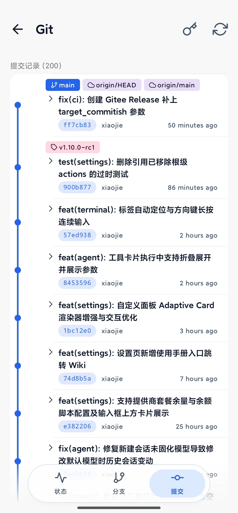
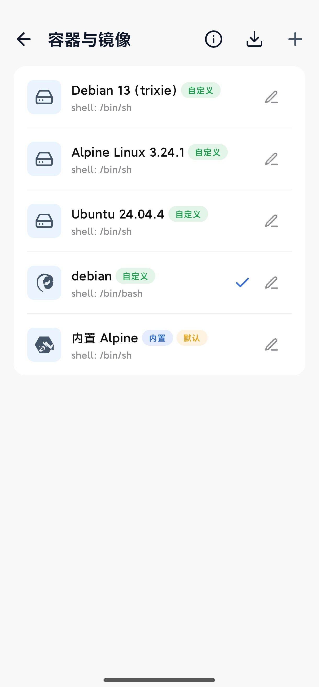

  
  <h1 align="center">AiCode MiUiX</h1>
  

    A miuix / HyperOS style UI fork of AiCode, based on jieapi/AiCode
     
    <a href="README.md">中文</a> · <a href="README.en.md">English</a>
  

> [!IMPORTANT]
> **This repository is an unofficial UI fork of AiCode, released under GPL-3.0.**
>
> - **Original author**: [jieapi](https://github.com/jieapi) (author of AiCode)
> - **Upstream repository**: [github.com/jieapi/AiCode](https://github.com/jieapi/AiCode)
> - **This repository**: [github.com/xzyy03/AiCode-MiUiX](https://github.com/xzyy03/AiCode-MiUiX)
> - **License**: [GPL-3.0](LICENSE), same as upstream; this fork is open source as well
> - **Scope of changes**: visual style only (miuix / HyperOS look), no business-logic changes

  
  
  

  <table>
    <tr>
      <td align="center"></td>
      <td align="center"></td>
    </tr>
    <tr>
      <td align="center">Home · AI Chat</td>
      <td align="center">Git · Commit History</td>
    </tr>
    <tr>
      <td align="center"></td>
      <td align="center"></td>
    </tr>
    <tr>
      <td align="center">Container · Image Manager</td>
      <td align="center">Models · Provider List</td>
    </tr>
  </table>

---

## Overview

AiCode is a universal AI coding agent that runs on Android, packing a full Linux development environment into your phone: it bundles an Alpine Linux container and terminal, and the AI agent can read and write files, run shell commands and run build tools, so writing, debugging and building all happen on-device. A remote SSH server can also serve as the execution backend, turning your phone into a mobile workstation for remote projects.

There is nothing to set up beforehand: install the app, configure a model under AI Vendors, and you can start coding — no computer, no environment to build yourself. AiCode ships no models and locks you into no vendor: it supports the OpenAI / Anthropic / Gemini protocols plus custom providers, with models, keys and endpoints all configured by you.

## Sponsors

| Icon | Description |
|------|-------------|
|  | **[RainYun](https://www.rainyun.com/logins_)** — Sponsor of this project's server; a Chinese cloud provider specializing in VPS and game hosting (one-click Minecraft and other game servers), plus bare-metal machines and object storage; discounts for new users |
|  | **[Axis AI](https://ai.onyxaxis.org/register?invite=FOAICODE)** — A free non-profit AI platform offering frontier models; register with invite code `FOAICODE` for 7 days of Go benefits |

## Advertisement

| Icon | Description |
|------|-------------|
|  | **[Qiniu Cloud AI](https://s.qiniu.com/vUryau)** — New users get 3,000,000 free tokens on sign-up (valid for 2 years), covering 50+ popular models |

## Features

### AI Agent

- **AI Agent** — Built-in tools for file read/write/edit, shell execution, background terminal, code & web search, image recognition, todo lists, and more; streaming output with live Markdown rendering and automatic context compression
- **Built-in browser** — A multi-tab WebView browser the AI can drive to navigate, click, fill forms and take screenshots to complete web tasks; supports night mode and local file previews
- **Parallel subagents** — Spawn subagents with their own isolated context to research, review or compare approaches in the background without blocking the current chat; a read-only **Explore** subagent is built in, and you can define your own with a custom model, tool set and prompt
- **Three run modes** — BUILD for normal development, PLAN for read-only planning (writes blocked at the tool layer), AUTO to approve everything without prompts — pick the permission scope you trust
- **Checkpoints & Undo** — Snapshots are recorded before the agent edits code; one-tap rollback of code, chat history, or both
- **Skills & Auto Memory** — Global/project-level skills and long-term memory let the AI reuse experience and project conventions across sessions
- **MCP Protocol** — Connect to local (stdio) or remote (HTTP) MCP servers to dynamically extend AI tool capabilities
- **Tool permissions & custom prompts** — Per-tool authorization rules; system prompts can be overridden by the user and survive app upgrades

### Models & Providers

- **Model-agnostic** — No bundled models and no vendor lock-in: models, keys and endpoints are yours to configure
- **Protocol support** — Compatible with the OpenAI / Anthropic / Gemini protocols, with presets for several official providers and support for custom ones; model lists and pricing are customizable
- **Multiple keys** — Configure several keys per provider with sequential or round-robin rotation; reasoning effort is adjustable

### Development Environment

- **Built-in Terminal & Container** — A local Linux container built on Termux and PRoot with a built-in Alpine image; supports custom rootfs images and host directory mounts; multi-tab terminals that can stay alive in the background
- **Remote SSH Mode** — Use a remote SSH server as the execution backend: commands, files and terminal all act on the remote project
- **Shizuku backend** — With Shizuku, the AI can run shell and adb commands on the host Android system to debug or operate other devices (requires per-call approval)
- **File tree & code editor** — An indented file tree that opens files in a full-screen editor with syntax highlighting for mainstream languages and Markdown preview; `file:line` links in AI replies jump straight to that line, in both local and remote SSH workspaces
- **Git Integration** — Visual management of status, branches, commit history, diffs and tags, plus staging/discarding changes, sign-off and credentials
- **Workspace Sync** — SFTP / FTP synchronization with a built-in FTP server for desktop file management

### Experience

- **Tablet & large screen** — Layout adapts to window width: a persistent sidebar on wide screens with code or terminal beside the chat, falling back to a single pane when narrow
- **Token stats** — Usage and cost estimates per provider and model, with a drill-down into individual calls
- **Appearance & language** — Light/dark themes, preset color schemes, Material You colors, custom background images, and a bilingual (Chinese/English) UI
- **Network proxy** — Configure a global proxy and per-provider proxies separately
- **Backup & Restore** — Encrypted export/import of provider configs, credentials, chat history and workspace files

## Getting Started

| Item | Description |
|------|-------------|
| System requirements | Android 8.0+ (API 26), arm64-v8a / x86_64 |
| Download | [GitHub Releases](https://github.com/jieapi/aicode/releases/latest): pick `armsolo` for real devices, `x86solo` for emulators, `universal` for both |
| Quick start | Settings → AI Vendors to add a model → Container & Images to pick local or SSH → new session and chat |
| Changelog | [Releases](https://github.com/jieapi/aicode/releases) (all versions & notes) |
| User guide | [Online docs](https://aicode.murk.top): quick start, user manual and advanced guides (same content as the in-app docs) |

## Star

If AiCode is helpful to you, give it a [Star](https://github.com/jieapi/aicode) — it helps more developers discover the project.

## Star History

<a href="https://www.star-history.com/?repos=jieapi%2Faicode&type=date&legend=top-left">
 <picture>
   <source media="(prefers-color-scheme: dark)" srcset="https://api.star-history.com/chart?repos=jieapi/aicode&type=date&theme=dark&legend=top-left" />
   <source media="(prefers-color-scheme: light)" srcset="https://api.star-history.com/chart?repos=jieapi/aicode&type=date&legend=top-left" />
   
 </picture>
</a>

## Feedback & Contribution

- **QQ group**: join the [AiCode QQ group](https://qm.qq.com/q/ByvqODJdIs) (group number: 1107110698) to share tips and feedback
- **Bug reports**: open an [Issue](https://github.com/jieapi/aicode/issues) with reproduction steps, device model and OS version
- **Feature requests**: discuss your ideas in [Issues](https://github.com/jieapi/aicode/issues)
- **Contributing**: submit a [Pull Request](https://github.com/jieapi/aicode/pulls)

## Acknowledgements

- [OpenCode](https://github.com/anomalyco/opencode) — Terminal-based AI coding tool, the core inspiration for this project
- [Termux](https://github.com/termux/termux-app) — Android terminal emulator, provided terminal components and PRoot solution
- [Kelivo](https://github.com/Chevey339/kelivo) — Cross-platform LLM chat client, AI conversation UI design reference

## Disclaimer

AiCode is provided "as is", for learning, research and lawful software development only. Using it for any illegal or infringing purpose is strictly prohibited, including but not limited to unauthorized access to, cracking or reverse engineering of others' software or systems, circumventing technological protection measures, stealing or leaking others' data, or distributing malicious code.

You bear all risks and responsibility for your use of this software. The authors and contributors shall not be liable for any loss arising from your use of, or inability to use, this software, nor for any act you perform using it or its consequences.

If you do not agree with this disclaimer, please stop using the software and uninstall it immediately.

## License

This project is licensed under [GPL-3.0](LICENSE).
